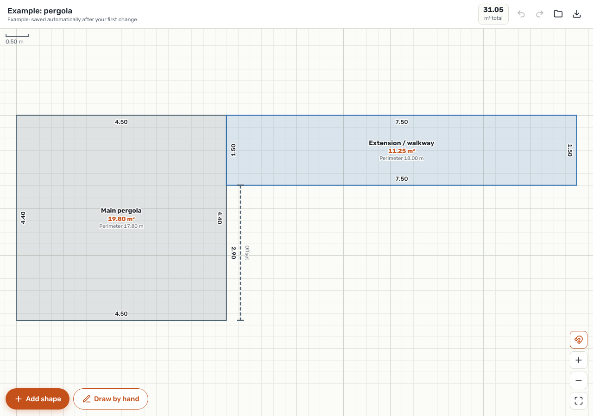
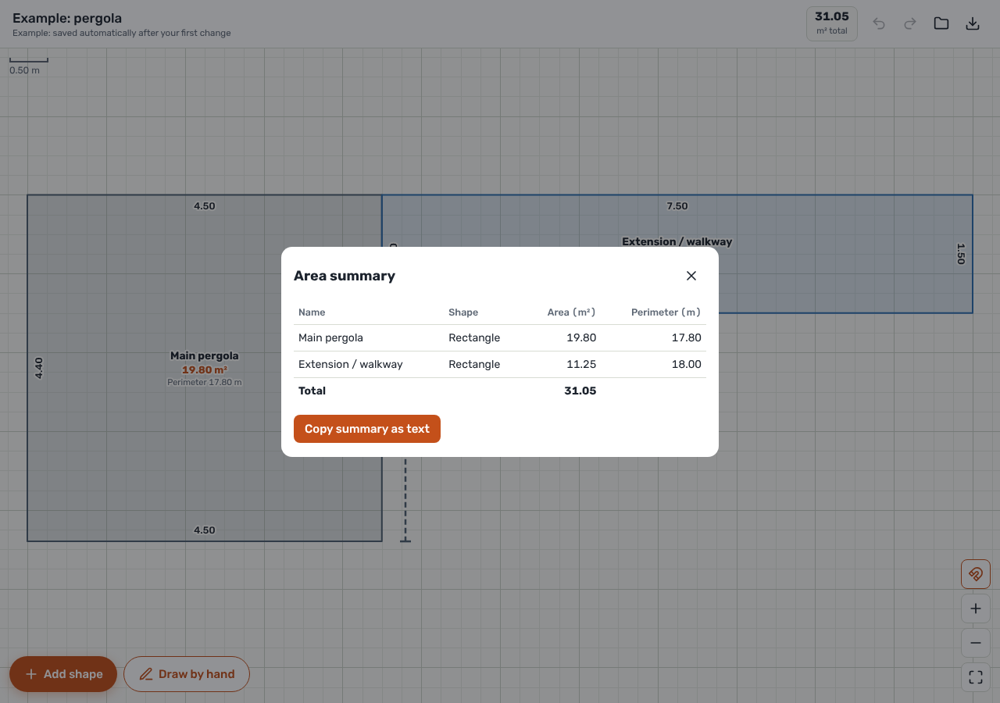
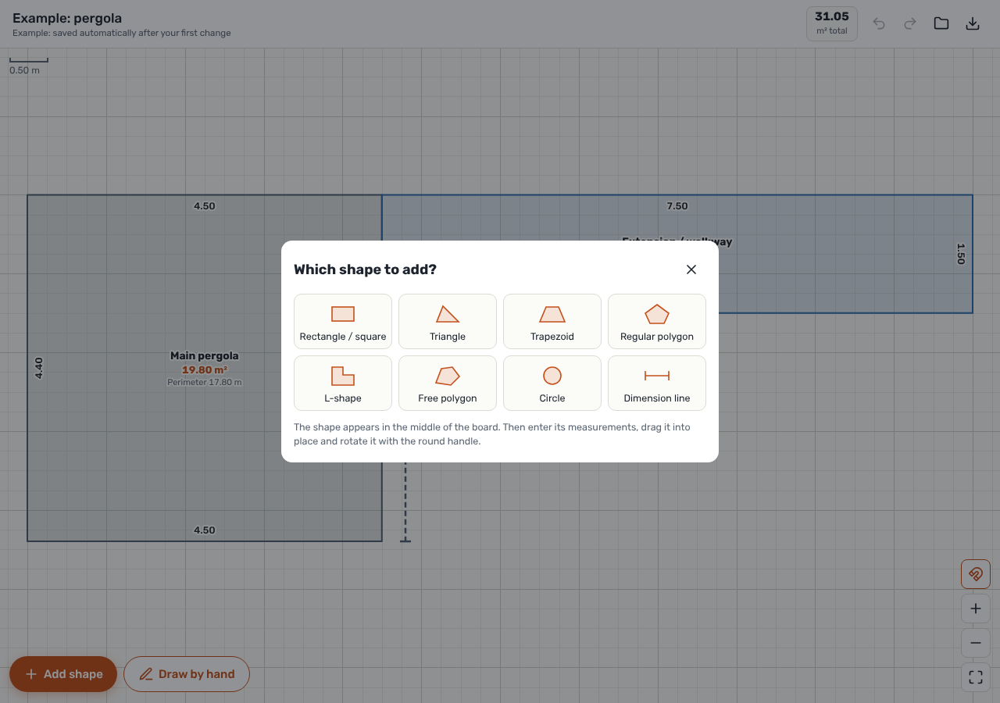
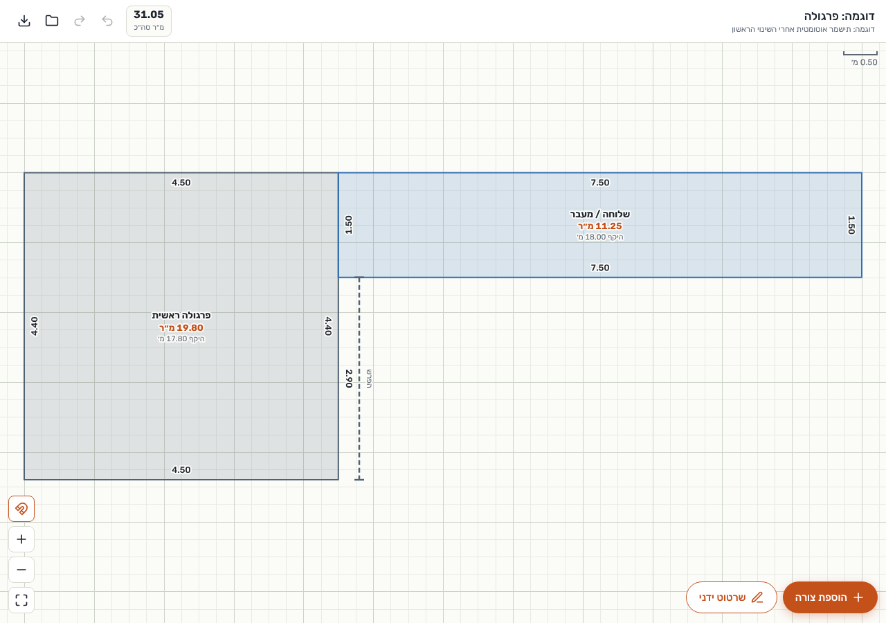
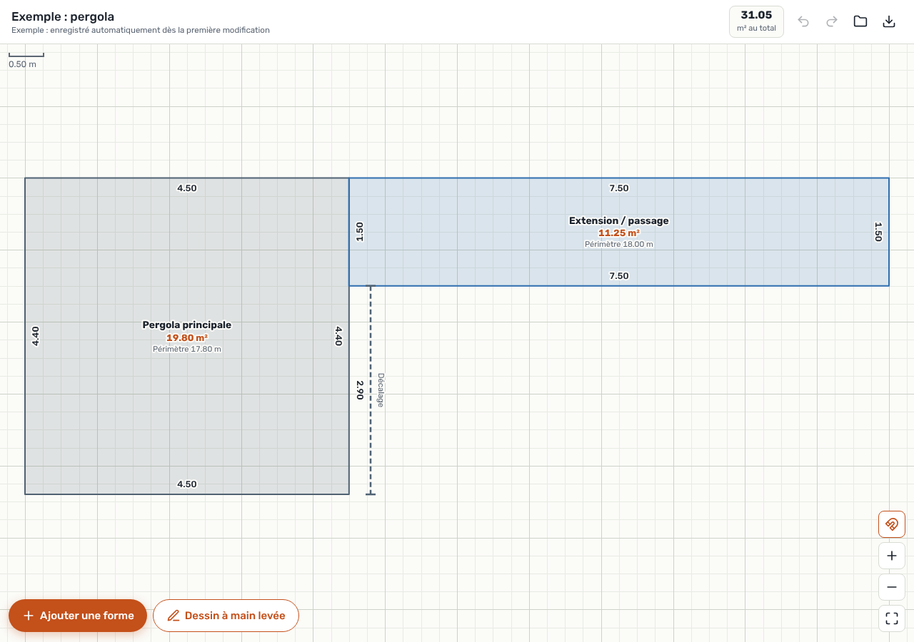

# Sirtuti

Dimensioned sketches for site visits. Draw rooms, lots and other elements, enter their measurements, and get the area and perimeter of every shape plus a total. Built for price quotes (painting, flooring, etc.): a fast, clean estimate, not a survey.

The app is available in Hebrew (RTL), English and French, with metric or imperial (feet/inches) units.

**Web app:** https://joka-7.github.io/Sirtuti/
**Desktop installers and Android APK:** see [Releases](https://github.com/joka-7/Sirtuti/releases/latest)

## Screenshots

| Sketch with dimensions | Area summary | Shape picker |
| :-: | :-: | :-: |
|  |  |  |

| Hebrew (right to left) | French |
| :-: | :-: |
|  |  |

## Features
- Ready-made shapes: rectangle, triangle, trapezoid, regular polygon, L-shape, circle, dimension line, and a free polygon defined by side lengths and angles.
- Hand drawing: point by point or freehand, with automatic straightening. Close the shape at the start point or leave it as an open line.
- Annotations on the sketch: free text (multi-line, resizable) and arrows, both draggable, rotatable and included in exports.
- Duplicate a sketch (*My sketches* → copy icon) to edit it under a new name without touching the original; export an editable sketch file and re-import it later.
- Choose whether the date appears in the header of exported PNG/PDF/Word files.
- Drag, rotate, snap to other shapes' corners, duplicate, undo/redo, bring to front / send to back.
- Area and perimeter per shape (each can be hidden), an area summary that can be copied as text.
- Export a sketch to PNG or a one-page A4 PDF with all dimensions and an area table.
- Settings: language (Hebrew / English / French) and units (metric m, m² or imperial ft-in, ft²). New users get their device language; values are always stored in meters, so switching units never changes a sketch.
- **Project documents:** notes-style site-visit summaries with client, address and date, headings, text (lines starting with `-` become bullets), checklists, sketches placed inline, and an automatic area summary across all sketches in the document. Tap a sketch to edit it and return to the document. Export to Word (`.docx`) or PDF with the sketches as images, right-to-left in Hebrew.
- Desktop app shows its version and tells you when a newer release is available.
- Optional Google sign-in to sync sketches across devices through your own Google Drive (a hidden app folder only Sirtuti can read; there is no Sirtuti server, so nobody else has a copy).
- Backup/restore of all sketches to a JSON file.
- Desktop app: auto-save every sketch to a folder you pick (use a Google Drive / OneDrive / Dropbox folder for a cloud backup).
- Works offline and installs as a PWA on phones and desktops.

## Install
- **Android / desktop Chrome or Edge:** open the web app → browser menu → *Install app*.
- **iPhone:** open in Safari → Share → *Add to Home Screen*.
- **Android app (APK):** download `Sirtuti_<version>_android.apk` from the latest release and open it; allow installing from your browser when asked. Install new versions over the old one. The auto-save folder and Google sign-in are not available in the Android app; use backup files or the web app.
- **Desktop app:** in the app, open *My sketches* (הסקיצות שלי) → *Desktop app* (אפליקציה למחשב). It detects your OS and links the right installer from the latest release. Or download the installer for Windows (`.msi` / `.exe`), macOS (`.dmg`) or Linux (`.AppImage` / `.deb`) from Releases. The builds are not code-signed, so Windows SmartScreen and macOS Gatekeeper will warn on first launch (macOS: right-click the app → *Open*).

## Where sketches are stored
- Project documents are stored the same way as sketches (same sync, folder and backup), as entries with `kind: "project"`.
- **Without sign-in:** only on the device (browser storage, or the desktop app's own storage).
- **Desktop app with an auto-save folder:** also as one file per sketch (`<name> (<id>).sirtuti.json`) in the chosen folder, rewritten on every change. Set it in *My sketches* (הסקיצות שלי) → *Auto-save to folder*. If the folder is synced by Google Drive, OneDrive or Dropbox, sketches are backed up to the cloud and shared between computers that use the same folder: new or changed files are picked up when the app opens or regains focus, and deleted files are removed.
- **Signed in with Google (web app):** on the device and in the user's own Google Drive (`appDataFolder`, one file per device `sirtuti-<deviceId>.json`, newest version of each sketch wins, deletes are kept as tombstones), synced across devices. Works offline and syncs when back online. Signing out removes the sketches from that device (they stay in Drive); *Delete all my data from Drive* removes them from Drive too and revokes the app's access.
- Google sign-in is not available inside the desktop app (Google blocks sign-in from embedded webviews). Use the installed web app for sync, or move sketches with backup files.

## Setting up Google Drive sync
Without this step the app runs fine, just without the account button.

1. In the [Google Cloud console](https://console.cloud.google.com), create a project (or reuse one) and enable the **Google Drive API** (`APIs & Services → Library`).
2. **Google Auth Platform → Data Access → Add scopes:** `https://www.googleapis.com/auth/drive.appdata` (non-sensitive: no verification and no user cap). **Audience:** click **Publish app** so the status is *In production*.
3. **Clients → Create client → Web application.** Under *Authorized JavaScript origins* add `https://joka-7.github.io` (no path) and, for local testing, `http://localhost:8000`. Leave redirect URIs empty.
4. Copy the **Client ID** into [`web/drive-config.js`](web/drive-config.js) as `window.SIRTUTI_GOOGLE_CLIENT_ID = '...'`. It is not a secret.
5. Commit and push. The Pages workflow redeploys the web app.

Google's sign-in script (`accounts.google.com/gsi/client`) is only loaded when the account dialog is opened or a session already exists, so people who never sign in never contact Google.

## Project layout
```
web/                         The app (static, no build step)
  index.html                 Entire UI: HTML, CSS and JS
  i18n.js                    English and French translations (keys are the Hebrew source strings)
  drive-sync.js              Google Drive sync (ES module, loaded on demand)
  drive-config.js            Google OAuth client ID (empty = no sign-in)
  vendor/docx.js             Bundled docx library for Word export
  sw.js                      Service worker for offline use
  manifest.webmanifest       PWA manifest
  icons/
src-tauri/                   Desktop app (Tauri 2) wrapping web/
tools/*-entry.js             Entries for the vendor bundles
tests/                       Unit tests (node --test) for the Drive sync module
.github/workflows/
  pages.yml                  Deploys web/ to GitHub Pages on push to main
  release.yml                Builds desktop installers on tag push (v*)
```

## Development
```bash
npm install
npm run dev                  # serve web/ at http://localhost:8000
npm run tauri dev            # run the desktop app (needs Rust + Tauri prerequisites)
npm test                     # unit tests for web/drive-sync.js
npm run build:docx           # rebuild web/vendor/docx.js after upgrading docx
```
Tauri prerequisites: https://v2.tauri.app/start/prerequisites/

## Translations
UI strings in `web/index.html` are Hebrew and wrapped in `tt("...")`; `web/i18n.js` maps each one to English and French. To add a string, wrap it in `tt()` and add its translations. To add a language, add an object to `i18n.js` and a button in the settings dialog.

## Releasing
1. Bump the version in `src-tauri/tauri.conf.json`, `src-tauri/Cargo.toml` and `package.json`.
2. Bump `VERSION` in `web/sw.js` so installed PWAs pick up the new files.
3. Push to `main` (web app deploys automatically), then run **Actions → Desktop release → Run workflow** (or push a tag like `v0.6.0`).
4. The workflow publishes release `v<version>` with the Windows, macOS and Linux installers, then builds, signs and attaches the Android APK.

### Android signing
The APK is signed with the keystore in the repository secrets `ANDROID_KEYSTORE_B64` (base64 of a `.jks` with alias `sirtuti`; it may be split, with the rest in `ANDROID_KEYSTORE_B64_2`) and `ANDROID_KEY_PASSWORD` (store and key password). Keep the same keystore forever: Android only installs an update over an existing app when it is signed with the same key. Without these secrets the workflow signs with a throwaway key and prints a warning; such builds must be uninstalled before installing the next one.

Android builds need the Android SDK and NDK locally (`npm run tauri android init`, then `npm run tauri android build --apk`); see https://v2.tauri.app/start/prerequisites/.

## License
MIT
